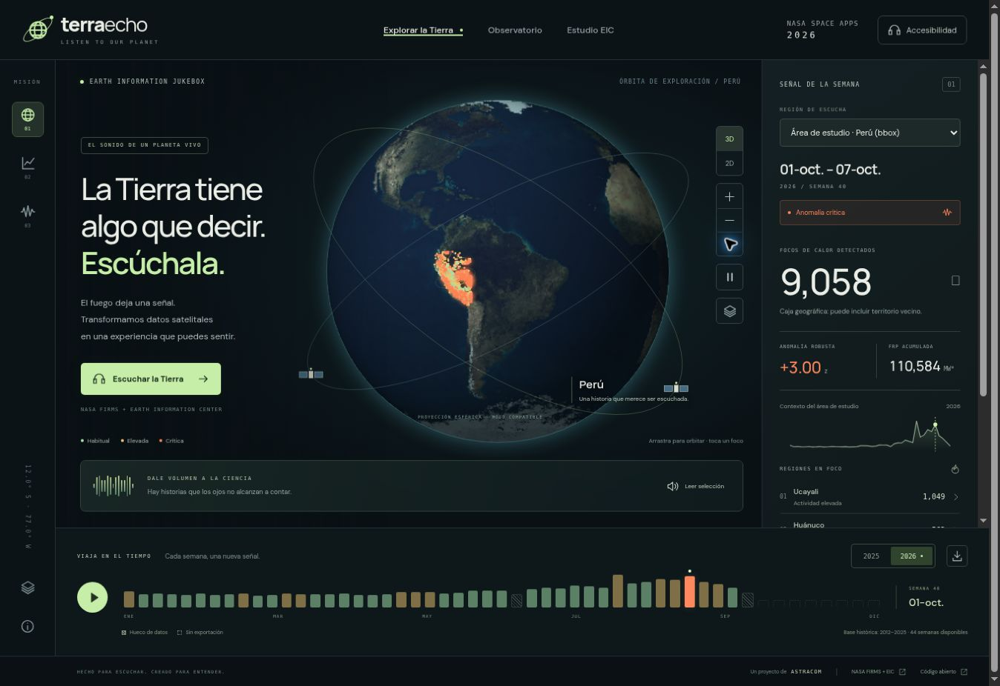
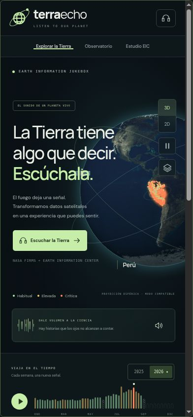
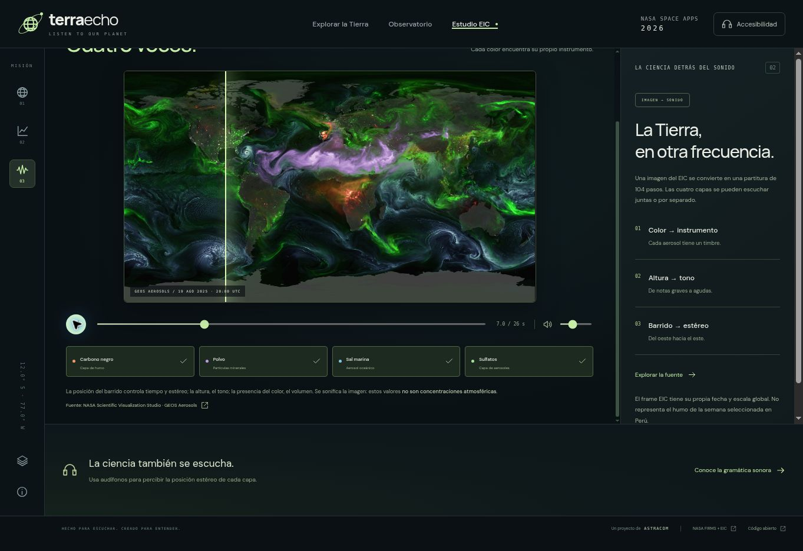

# Implementation validation · November 15, 2026

## Completed checks

| Check | Result |
| --- | --- |
| `npm run test:web` | 11 tests pass: exported contracts, gap silence, regional agreement, bounded audio inputs, CSV unknowns, FIRMS parsing, UTC times, query validation, API snapshots and explicit missing-key errors |
| `npm run typecheck` | Pass |
| `npm run build` | Pass; Next.js generates the page and dynamic `/api/fires` and `/api/health` routes |
| `python tests/test_pipeline.py` | Original Python tests pass; scientific modules are unchanged |
| Desktop browser | Explorer, compatible globe, regional filter, keyboard week selection, observation metrics and 2D map verified |
| Observational table | All 44 rows of the 2026 export rendered; regional values and gap labels checked |
| Audio controls | Fire playback activates and stops; selecting the last 2026 week shows insufficient data and silence |
| EIC studio | Actual NASA frame loaded; transport advanced from 0.0 to 7.5 seconds and paused; all four layer controls rendered |
| Source dialog | Remains open in React strict mode; missing FIRMS key produces a clear configuration message; Escape closes it |
| Mobile iframe | 390 CSS-pixel viewport checked; body scroll width equals viewport width, no horizontal overflow |
| Screenshots | Desktop, mobile and EIC views saved in `docs/screenshots/` |

The API tests invoke the actual Next.js route handlers in process. Managed preview runs in a separate network namespace, so a shell localhost HTTP probe could not reach it; this is not presented as a successful network smoke test. The browser did load the historical API and check the missing-key API through the real interface.

## Verification limits

- The review browser disables WebGL. The compatible spherical projection was exercised; accelerated Three.js rendering was compiled and typechecked, but still needs a visual check on a WebGL-capable device.
- No actual FIRMS MAP_KEY was supplied, so a successful live NASA API fetch was not verified. Parser and validation tests use explicit test CSV fixtures, not fabricated product observations.
- No Python HTTP service exists in this change. Only the provider adapter and stable contract are ready.
- Audio control state, scan progress and silence handling were verified. Human listening quality and accessible interpretation still require headphone and participant testing.
- This is a responsive-layout check at a mobile viewport, not a test on a physical iOS/Android device or a formal WCAG audit.
- The existing exported figures were not reprocessed from original NASA downloads. National clipping and source manifests remain upstream data work; see `WEB_ARCHITECTURE.md`.
- Production hosting and GitHub Actions execution are separate from these local checks. No live hosting URL is asserted here.

## Review captures

