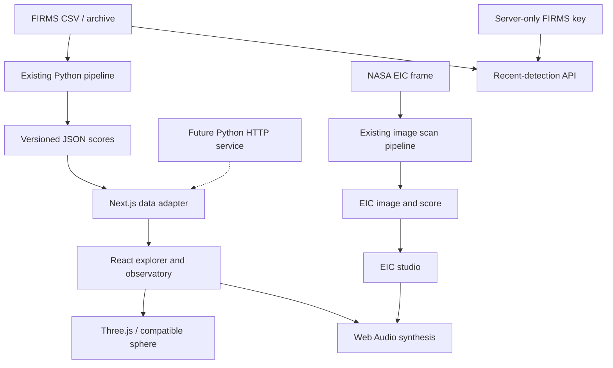

# TerraEcho web architecture

The existing Python pipeline remains independently runnable. The web app lives in `web/` and consumes its exported scores. No raw FIRMS data, anomaly calculations or credentials are bundled into client code.

## Boundaries

| Workstream                   | Owns                                                                                | Stable interface                         |
| ---------------------------- | ----------------------------------------------------------------------------------- | ---------------------------------------- |
| Data science / Python        | acquisition, QA, national clipping, anomaly and score exports                       | `data/scores/terraecho_<year>.json`      |
| Web / API                    | validation, snapshot loading, future Python service adapter, protected FIRMS proxy  | `GET /api/fires`                         |
| Visual exploration           | Three.js scene, compatible spherical renderer, 2D map, timeline, region filters     | `FireWeek`, `CellVoice`, `GeoCollection` |
| Signal engineering           | synthesis of score parameters, compression, envelopes, stereo, EIC voices           | `Sonifier.fire()` and `Sonifier.eic()`   |
| Accessibility / presentation | keyboard paths, descriptions, spoken selection, reduced motion, source explanations | the same selected region and week        |

Teams can work with the existing exported JSON immediately. The future Python service can replace the score provider through a server environment variable without changing visualization or audio components.

## Repository layout

| Path                                 | Purpose                                                                    |
| ------------------------------------ | -------------------------------------------------------------------------- |
| `terraecho/`, `run.py`, `run_eic.py` | Existing scientific pipeline, unchanged                                    |
| `web/src/app/`                       | Next.js App Router, metadata and API routes                                |
| `web/src/components/`                | Product views, scene renderers and controls                                |
| `web/src/lib/types.ts`               | Shared TypeScript contract                                                 |
| `web/src/lib/theme.ts`               | Shared navy/cyan palette for CSS, Three.js, Canvas and SVG; see `THEME.md` |
| `web/src/lib/data.ts`                | Score validation, polygon filtering, formatting and CSV export             |
| `web/src/lib/audio.ts`               | Web Audio engine; no autoplay                                              |
| `web/src/lib/firms.ts`               | FIRMS CSV parser and bounded query validation                              |
| `web/src/lib/server-data.ts`         | Local snapshot / future Python HTTP adapter                                |
| `web/scripts/prepare-data.mjs`       | Copies existing scientific outputs to public assets before dev/build       |
| `web/public/textures/earth.jpg`      | Local Earth texture; credits in `ASSETS.md`                                |
| `.github/workflows/web-ci.yml`       | Contract tests, typecheck and production build                             |

## Scene and sound behavior

The primary scene uses Three.js, OrbitControls, a local Earth texture, atmosphere shader, geodetic guides, georeferenced fire cells, department boundaries and illustrative orbiting satellites and wave rings. Its resources are released when leaving the explorer. Frame rate and pixel ratio are bounded. Rotating is paused when requested, with system reduced-motion preferences respected.

On devices without WebGL, a Canvas 2D renderer inverse-projects the same Earth texture onto a spherical surface and projects the same cells and boundaries. It supports drag, zoom, layers and inspection. This is explicitly marked as a compatible spherical projection; it is not an accelerated Three.js scene. The separate 2D Peru map is also available. Validation of accelerated rendering still requires a WebGL-capable browser.

The audio engine consumes the Python fields directly. To keep the sound interpretable and processing bounded, a selection plays its 18 highest-FRP cells, including their pulse density, detuning, interval and stereo pan. All cells contribute to the provided aggregate metrics. No voices are produced for a data-gap week or a selection with no cells. Browser activation is required; leaving a view or hiding the page stops playback. EIC has separate transport controls and uses the exported harmonics of each layer.

## Scientific scope that must remain visible

- Available tracks: 2025 (52 weeks) and 2026 (44 weeks). Years 2012 onward are baseline inputs, not exported navigable tracks in this version.
- The existing `country` aggregate is a bounding-box aggregate. In week 40 of 2026 it reports 9,058 hotspots, while the sum of regional counts is 5,921. `load_firms()` applies the rectangular bounds and `run.py` sums that grid; department aggregates assign grid centers to polygons. Do not call the general total a count exclusively inside Peru. The UI labels it as the study area and does not silently recalculate the anomaly.
- National geographic clipping must be fixed upstream and **all baseline years and scores regenerated** before national totals can be compared consistently. Simply dropping outside cells in the browser would leave counts and anomalies with different denominators.
- 2026 is provisional; weeks with gaps have unknown anomaly, not zero anomaly.
- “Normal” means statistically typical fire activity, not verified forest health. No hotspot-to-hectares conversion or operational emergency prediction is made.
- The EIC image is a global modeled-aerosol frame from a different date. Its color-derived score is not aerosol concentration and is not evidence of smoke caused by the currently selected Peru fires.
- Original downloaded source files and retrieval manifests are not present in this checkout. Existing exports are presented as team-provided pipeline results, not independently revalidated NASA downloads.

## Deferred, independent improvements

1. Data: national clipping, source hashes/retrieval dates, full 2012–2026 exports and documented coverage.
2. Python API: implement `GET /v1/scores/{year}` using `API_CONTRACT.md`; the adapter already exists.
3. Audio: compare the 18-cell mix with the offline reference WAV and run listening tests.
4. Accessibility: user tests with screen readers and blind participants; no WCAG certification is asserted.
5. Storytelling: connect a Peru-centered EIC frame/date to a matching FIRMS window if a comparable source can be obtained.

These are delivery lanes, not blocked dependency chains. Each can use the versioned score contract and existing fixtures while the others progress.
