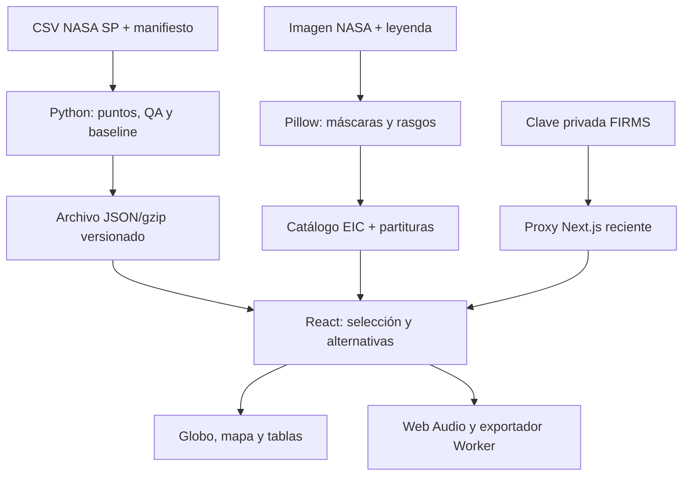

# Arquitectura TerraEcho

La web completa usa Next.js/React/TypeScript; Python produce archivos versionados y no atiende cada visita. EIC y FIRMS mantienen contratos y relojes científicos independientes.

| Carril | Entrega independiente | Contrato / cierre |
| --- | --- | --- |
| Ciencia FIRMS | Raw-point clipping, referencia fija, QA, scores | `science.py`, gzip, catálogo y manifiestos; conteos reconciliados |
| EIC | Imagen, ficha, máscaras y rasgos | Catálogo y esquema 2 validados; revisión independiente pendiente |
| Señales | Timbres, transporte, mezcla y WAV | Parámetros compartidos; picos medidos; comprensión pendiente |
| Acceso/UX | Guía, teclado, tabla, mono, voz y errores | Mismos datos; evidencia automática separada de pruebas humanas |
| Web/entrega | Vistas, API privada, CI y artefactos | Build íntegro, control de versiones y despliegue sin secretos |

Las personas responsables se asignan en el equipo; no se inventan nombres ni se envían invitaciones. Cada carril puede usar los contratos versionados inmediatamente, sin esperar un futuro backend Python.

`science.py` es el procesador nuevo. Los scripts originales permanecen como investigación heredada. `frames.py` y `prepare_eic_catalog.py` crean el catálogo nuevo. `prepare-data.mjs` verifica/prepara los archivos públicos antes de dev/build. La aplicación completa lee snapshots o un proveedor Python explícito; la demo estática usa directamente esos mismos archivos.

La escena Three.js libera recursos al desmontar o perder contexto. Hay proyección esférica compatible, mapa plano y tabla paginada de todas las celdas. El raycast compara la superficie antes de aceptar un marcador. Órbitas/ondas son ilustraciones. La inspección GPU real y táctil sigue pendiente.

EIC programa notas con el reloj de AudioContext y anticipación; React actualiza la línea visual desde ese reloj. Si una nota expiró durante suspensión, se omite en vez de crear una ráfaga. La exportación WAV ocurre en un Worker. Archivo FIRMS y consulta reciente tienen gramáticas separadas: reciente no inventa z ni acorde de anomalía.

La mezcla histórica toma 18 celdas de mayor FRP conocida para acotar densidad y cómputo. Se informa qué proporción de conteo/FRP representa; la tabla permite escuchar una celda omitida. No se presenta el límite de voces como optimización perceptual validada.

No hay usuarios, datos personales, almacenamiento de respuestas de participantes, alertas operativas ni predicción. La clave nunca se sirve al navegador. Publicación: artefacto completo y versionado, no archivos de datos escritos por visitantes.
